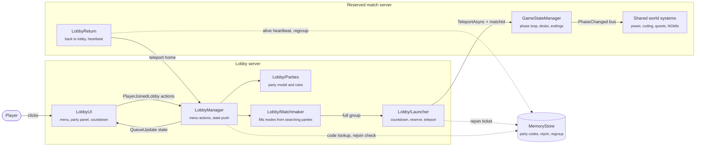
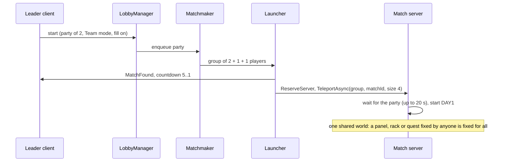

# Not Gonna Make It

> A multiplayer psychological horror survival game for Roblox. Code your project through the day, then survive the night when the venue corrupts and your fellow hackers turn into NGMIs.

---

## About The Project

Not Gonna Make It is a co-op Roblox horror game written in Luau and synced to Studio with Rojo. Up to four players queue into a private match server and play out a doomed hackathon. You explore the venue and meet the organizers by day, grind out your project at coding terminals, then fight to survive once the building, and everyone in it, starts to fall apart.

A match runs through five phases on a shared, server-authoritative clock. Halfway through Day 2 the corruption sets in. The lighting warps, the audio distorts, and the NPC hackers around you begin mutating into NGMIs ("Not Gonna Make It"). By Night 2 the game switches to first-person survival horror, and your ending depends on whether you make it out and how much of your project you finished.

**Features:**

- Parties with public, friends-only and private lobbies, join codes, friend invites, ready checks and an open-party browser
- Matchmaking for 1, 2, or 4-player co-op that fills open slots, using reserved match servers, with rejoin and regrouping after a match
- Five-phase match loop (Lobby, Day 1, Day 2, Night 2, Day 3) on a synced day/night clock
- Third-person exploration by day, first-person survival horror at night
- Day 2 corruption system: at the halfway mark the venue warps and the NPC hackers mutate into NGMIs
- Coding minigame at terminals, where your completion percentage decides which ending you get
- Scavenging and inventory: energy bars to refill sprint, deodorant to throw off NGMIs, flashlight batteries
- Stamina-based sprint, battery-powered flashlight, electrical-panel puzzles, power management, and side quests
- Narrative cutscenes: the opening ceremony, the Day 1 to Day 2 sleep transition, the Day 2 to Night 2 corruption sequence, and branching Bad and True endings

---

## Built With

[](https://www.roblox.com/)
[](https://luau.org/)
[](https://rojo.space/)
[](https://github.com/rojo-rbx/rokit)
[](https://kampfkarren.github.io/selene/)
[](https://github.com/JohnnyMorganz/StyLua)

---

## Architecture

The game runs on two kinds of server built from the same place. A public **lobby server** hosts the menu, parties and matchmaking. When a match is found, the lobby reserves a fresh **match server** (`TeleportService:ReserveServer`) and teleports the whole group there, where the five-phase match runs isolated from everyone else. `server/ServerRole` tells them apart: a reserved server has a `PrivateServerId` and no `PrivateServerOwnerId`. In Studio there is only one server, so the match runs on the lobby server.



Lobby rules, applied in order on the server (clients only send requests):

1. Every lobby player is always in exactly one party; a new player leads a party of one.
2. The leader sets the mode (its size cap: 1, 2 or 4), the privacy (public, friends of the leader, or private) and whether matchmaking may fill open slots.
3. A join from the open-party list respects privacy; a join code or game invite skips it. A code or invite for a party on another lobby server teleports the player to that server.
4. Start needs every member ready. A full party, or one with fill off, goes straight to the countdown; otherwise it searches, and the matchmaker groups searching parties whose sizes add up to exactly the mode, longest wait first.
5. Anyone leaving the server or the party during the 5 second countdown cancels it; parties that were searching go back to searching in their old place.



On the match server all world state is server-owned and shared: panels, server racks, lights, objectives, the boss and the Day 2 project (one team project; each teammate's task moves it, two tasks per teammate reach 100 percent). Side-quest progress and rewards go to the whole team, and "find your desk" waits for every teammate to reach their own desk.

Limits and guarantees:

- Teleports retry once; a group that never leaves is released back to the menu after 45 seconds.
- Rejoin is offered while the match server's heartbeat (every 30 seconds, 90 second expiry) is fresh and stops at Day 3; tickets expire after 20 minutes.
- Players returning from a match are sent to the lobby server and party of the first teammate home; if that server is full they land on any lobby server.
- Without MemoryStore access (Studio, outages) codes, invites and parties still work within one server.

---

## Getting Started

### Prerequisites

- Roblox Studio with the Rojo plugin installed
- Rokit, the toolchain manager. It installs the exact tool versions pinned in `rokit.toml` (Rojo 7.4.4, Selene, StyLua).

### Installation

```sh
git clone https://github.com/teddycitrus/not-gonna-make-it.git
cd not-gonna-make-it

# Install the pinned toolchain (Rojo, Selene, StyLua)
rokit install

# Start the Rojo server, then click "Connect" in the Rojo Studio plugin
rojo serve
```

To produce a standalone place file instead of live-syncing:

```sh
rojo build -o NotGonnaMakeIt.rbxl
```

### Project Structure

```
src/
  server/   ServerScriptService   (game state, AI, matchmaking, world build)
  client/   StarterPlayerScripts   (camera, UI, input, VFX)
  shared/   ReplicatedStorage      (configs, item and NPC definitions, utils)
  gui/      StarterGui             (HUD, menus)
```

---

## Usage

### Controls

| Input | Action |
|---|---|
| `WASD` and Mouse | Move and look |
| `Left Shift` (hold) | Sprint, drains your energy bar |
| `Space` | Jump |
| `E` | Interact: talk to NPCs, pick up items, use terminals |
| `1` to `4` | Select inventory slot |
| `Q` | Drop the held item |
| `F` | Toggle flashlight (Night 2) |
| `Esc` | Close the active panel or puzzle |

Dev and admin builds expose a free cam and admin panel on `V`.

### Match Flow

1. **Lobby**: form a party, pick Solo, Duo or Team, ready up and start, or search for players to fill open slots.
2. **Day 1** (3 min): opening ceremony, meet the NPCs, find your desk, learn the venue.
3. **Day 2** (10 min): code at your terminal and scavenge supplies. Corruption begins at the 5 minute mark.
4. **Night 2** (15 min): first-person survival horror against the NGMIs. Keep the power on, repair server racks, stay lit, and stay hidden.
5. **Day 3**: an ending cutscene decided by your survival and project completion. Bad Ending under 100 percent, True Ending at 100 percent.

---

## Roadmap

- [x] Matchmaking with reserved match servers (1, 2, or 4-player)
- [x] Parties: privacy, codes, invites, ready checks, rejoin and regroup
- [x] Five-phase match loop with a synced, server-authoritative day/night clock
- [x] Day 2 corruption system, NPC hackers mutate into NGMIs
- [x] Narrative cutscenes including the Day 2 to Night 2 transition and branching Bad and True endings
- [x] First-person Night 2 survival with flashlight, power management, and server rack repair
- [ ] Polish the NGMI transformation poses (forearm articulation in the corruption cutscene)
- [ ] Per-player settings and accessibility options
- [ ] Additional endings and content after Night 2

---

## Contributing

Contributions are welcome. To contribute:

1. Fork the repo
2. Create a feature branch (`git checkout -b feature/your-feature`)
3. Commit your changes (`git commit -m 'Add your feature'`)
4. Push to the branch (`git push origin feature/your-feature`)
5. Open a Pull Request

Run `selene src` and `stylua src` before opening a PR so changes stay lint-clean and consistently formatted.

---

## License

Distributed under the MIT License. See `LICENSE` for details.

---

## Contact

teddycitrus: https://github.com/teddycitrus

Project: https://github.com/teddycitrus/not-gonna-make-it

---

## Acknowledgments

- [Rojo](https://rojo.space/) for filesystem to Roblox Studio sync
- [Rokit](https://github.com/rojo-rbx/rokit) for toolchain version management
- [Selene](https://kampfkarren.github.io/selene/) and [StyLua](https://github.com/JohnnyMorganz/StyLua) for Luau linting and formatting
- [Img Shields](https://shields.io) for badges
